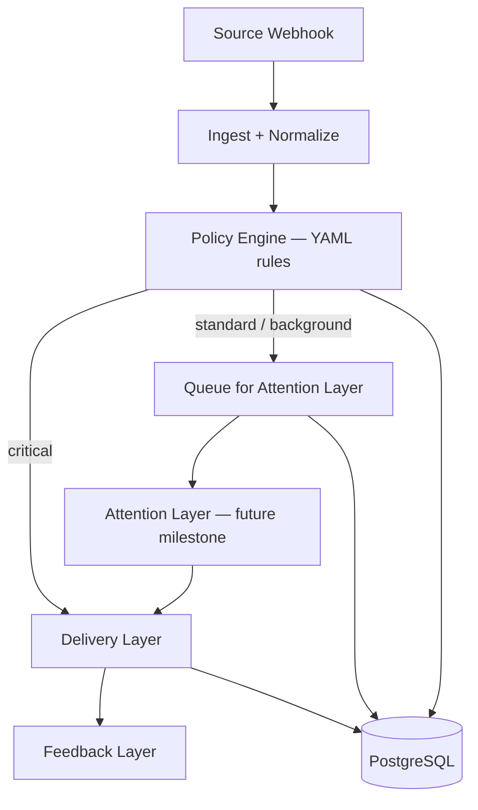

# Attention Orchestration Platform Architecture

Modern notification systems must *respect user attention* rather than simply broadcasting alerts. Early work by Horvitz et al. described a "notification platform" that sits as an **attention-savvy layer** between incoming messages and the user, weighing the value of information against the cost of interruption. In our design, we take this further: instead of a pure "notification delivery platform," we build an **Attention Orchestration Platform** that uses AI only in the middle layer.

## Pipeline Overview

```
Sources (GitHub, Jira, Webhooks…)
   → 1. Event Layer        (deterministic: ingest, normalize, validate, dedupe)
   → 2. Attention Layer   (AI: classify, group, schedule, digest — Standard/Background only)
   → 3. Delivery Layer    (deterministic: format and route to channels)
   → 4. Feedback Layer    (capture reactions, preferences, undo)
   → Future Learning
```

**Critical events bypass Layer 2 entirely.** The pipeline evaluates policy rules in Layer 1 and routes critical events straight to delivery.



Each layer has distinct responsibilities, minimizing where AI is needed and keeping the rest deterministic:

- **Event Layer:** Ingests and normalizes events from all sources (e.g. GitHub PRs, Jira issues, custom webhooks). Applies *deterministic logic*: validate fields, deduplicate repeated events, and run data-driven rules to assign an *attention class*. An **event bus / publish-subscribe** pattern (NATS, future milestone) decouples sources from processors. If an event is classified as **Critical**, it bypasses the Attention Layer and proceeds immediately to delivery.

- **Attention Layer (LLM Classification):** The AI-controlled heart of the system. Classifies and groups non-critical events, schedules them, assigns priorities, and generates summary digests. Only "standard" and "background" events enter this layer. Critical events never touch AI.

- **Delivery Layer:** Multi-channel notification hub (email, Slack, SMS) through a provider abstraction. No AI — merely formats and routes messages. Integrates with Novu (or similar) through a `NotificationProvider` interface. Observes success/failure and respects user channel preferences.

- **Feedback Layer:** Logs user responses (opened, dismissed, snoozed, replies) and provides one-click feedback in digests. Interactive controls: *Always Notify*, *Never Notify*, *Undo*. Captured reactions feed future learning.

## Canonical Event Schema

Every event carries first-class attention metadata. JSON API responses use camelCase; PostgreSQL columns use snake_case.

### Go domain model

```go
type Event struct {
    ID             string
    Source         string                 // e.g. "github"
    EventType      string                 // e.g. "pull_request"
    Repository     string                 // e.g. "octo/repo"
    AttentionClass string                 // "critical" | "standard" | "background"
    DecisionState  *DecisionState
    Payload        map[string]interface{} // raw source payload
}

type DecisionState struct {
    Status       string  // "sent" | "queued" | "merged" | "digest" | "delayed" | "budget_exceeded"
    Reason       string  // deterministic reason, never LLM-generated
    ModelVersion string  // set only when Attention Layer makes the decision
    Confidence   float64 // 0.0–1.0, set only for AI decisions
    MatchedRule  string  // name of the policy rule that matched
}
```

### JSON representation

```json
{
  "id": "github-pull_request-1234567890",
  "source": "github",
  "eventType": "pull_request",
  "repository": "octo/repo",
  "attentionClass": "standard",
  "decisionState": {
    "status": "queued",
    "reason": "default routing",
    "matchedRule": "default-github"
  },
  "payload": { }
}
```

### Decision status lifecycle

| Status | Set by | Meaning |
|---|---|---|
| `sent` | Pipeline (critical) or Attention Layer | Delivered immediately |
| `queued` | Pipeline (standard/background) | Waiting for Attention Layer |
| `merged` | Attention Layer | Combined with similar events |
| `digest` | Attention Layer | Held for digest delivery |
| `delayed` | Attention Layer | Scheduled for later (e.g. outside work hours) |
| `budget_exceeded` | Attention Layer | Standard event deferred — daily attention budget spent |

Critically, **all decision details are logged at write time** (not recomputed). This ensures we can always trace "why was this notification hidden six months ago?" without re-running the model.

## Notification Classes: Critical, Standard, Background

Three priority tiers with fixed policies:

- **CRITICAL**: Delivered immediately. Bypasses quiet modes, focus filters, and AI. Never delayed, merged, or budget-limited. *(P1 incident, security breach, payment failure.)*

- **STANDARD**: Normal priority. The Attention Layer may group, delay, or summarize. Consumes attention budget when delivered. *(PR review request, new assignment, team comment.)*

- **BACKGROUND**: Low priority. No real-time alerts; shown in digests or dropped when busy. Does not consume attention budget. *(Repo stars, minor comments.)*

This mirrors iOS interruption levels: Critical alerts bypass everything; Active maps to Standard; Passive maps to Background.

## Attention Budget vs Suppression

We avoid "suppression" — users don't like feeling ignored. Instead, each person has a finite **attention budget** (default: ~5 standard notifications per day):

- **Critical** → costs zero budget, always delivered.
- **Standard** → consumes 1 budget slot when delivered.
- **Background** → costs zero (lives in digest or vanishes).

When the budget is exceeded, standard events receive `decision_state.status = budget_exceeded` and are held until the next daily reset. Only critical items break through.

## The Central Role of Digests

Digests are the explainability interface. Instead of "AI decided something," users see:

> **Today's Digest:**
> ✓ *Merged* 8 Jira comments (you usually ignore these).
> ✓ *Delayed* 3 GitHub PR reviews (outside work hours).
> ✓ *Sent Immediately* – P1 incident, Security alert.
> ✓ *Held* – 12 repo stars (background, digest only).
> *[Undo] [Always Notify] [Never Notify]* on each item.

Machine logic determines the decision; the LLM only rephrases it into plain English:

> Machine Logic (exact condition met) → **LLM** → Human-Readable Explanation

This avoids hallucinated explanations and keeps past rationale stable even when models change.

## User Feedback and Preferences

Embedded controls in notifications and digests:

- **Undo / Revert** — reverse an AI decision.
- **Always / Never Notify** — binary policy update for an event type.
- **Mute Similar** — silence a category.
- **Looks Good** — positive reinforcement.

Static preferences (quiet hours, channel selection) live in user profiles. Both automated modeling and explicit control combine for a transparent experience.

## Rule Engine and Pipeline

Every source plugs into the same framework via **data-driven YAML rules**:

```yaml
rules:
  - name: github-security-alert
    when:
      source: github
      eventType: security_advisory
    then:
      attentionClass: critical
      reason: security vulnerability detected

  - name: default-github
    when:
      source: github
    then:
      attentionClass: standard
      reason: default routing
```

Adding a new connector is *connector + rules*, not rewriting core logic. The rule engine evaluates conditions deterministically (source, event type, repository). First match wins.

Rules file path is configured via `RULES_PATH` environment variable. Invalid rules fail fast at startup.

## Multi-Agent Recipients

Recipients are abstracted for future agent-to-agent workflows:

```go
type Recipient interface {
    Receive(Notification) error
}
```

V1 targets human channels (email, Slack, SMS). Later: AI agents, webhooks, workflow endpoints.

## Delivery Provider Abstraction

The delivery layer uses a provider interface, never tightly coupled to Novu:

```go
type Provider interface {
    Send(req NotificationRequest) error
    Name() string
}
```

Implementations: `StubProvider` (dev), `SMTPProvider` (email), future `NovuProvider`, `SlackProvider`.

## Technology Stack

| Component | Choice | Notes |
|---|---|---|
| Backend | Go | Clean Architecture, dependency injection |
| Frontend | React + TypeScript | Dashboard and digest UI |
| Database | PostgreSQL | Events, decisions, feedback, preferences |
| Cache | Redis | Future: dedup keys, budget counters |
| Messaging | NATS | Future: event bus between layers |
| Delivery | Novu (via abstraction) | Multi-channel routing |
| AI | Ollama / external LLM | Attention Layer only |
| Local dev | Docker Compose | Postgres, Ollama, API, UI |

## Implementation Status

| Component | Status |
|---|---|
| Event ingestion (GitHub webhook) | Implemented |
| Policy engine + YAML rules | Milestone 11 |
| Critical → delivery pipeline | Milestone 11 |
| PostgreSQL persistence | Milestone 11 |
| `decision_state` first-class fields | Milestone 11 |
| SMTP delivery provider | Implemented |
| Feedback capture (`/feedback`) | Implemented |
| Attention Layer (AI classify/schedule) | Planned |
| Attention budget enforcement | Planned |
| Digest generation + interactive UI | Planned |
| Novu provider | Planned |
| NATS event bus | Planned |
| Deduplication / threading | Planned |
| Learning from feedback | Stub (Ollama summarizer) |

## Roadmap Priorities

1. **Core Pipeline** *(Milestone 11 — current)*: Wire ingestion → policy → critical delivery → persistence. YAML rules. Canonical schema.
2. **Reliable Delivery**: Novu integration for email, Slack, SMS. Critical delivery guarantees.
3. **Attention Layer**: AI classifiers for standard events. Deduplication, grouping, scheduling, digests.
4. **Feedback Loop**: Interactive digest interfaces with Undo/Always/Never. Training labels.
5. **Learning**: Refine thresholds and personalize attention budget from feedback.
6. **Advanced**: Admin dashboard, multi-agent routing, analytics, NATS event bus, compliance.

Each piece depends on the rule/pipeline foundation. The goal is systems that respect attention, reduce friction, and help people stay focused on what matters.

**Sources:** Novu design guide (digests, multi-channel), Apple notification summaries, Horvitz et al. (intelligent notification platform), MagicBell UI patterns.
